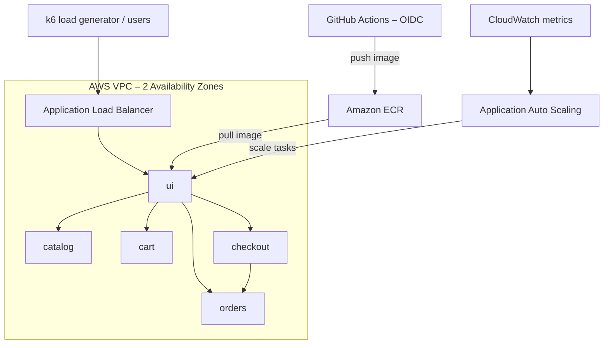

# CPU-based vs Request-based Autoscaling for Cloud-Native Microservices on AWS ECS Fargate

> **Course:** Distributed Computing Systems (*Hệ tính toán phân bố*) – Group 14
> **Topic:** Cloud-native microservices with autoscaling

## 1. Problem Statement

Reactive autoscaling based only on CPU utilization often reacts too late to
user-perceived latency during traffic spikes. Tail latency (p95, p99) can
violate Service Level Objectives before CPU thresholds are reached.

This project deploys a multi-service retail application on **Amazon ECS Fargate**
and experimentally compares two autoscaling policies:

1. **CPU-based target tracking** (`ECSServiceAverageCPUUtilization`)
2. **Request-based target tracking** (`ALBRequestCountPerTarget`), motivated by
   **Little's Law** (L = λW): concurrency grows with arrival rate before CPU saturates.

## 2. System Architecture

- Workload: [aws-containers/retail-store-sample-app](https://github.com/aws-containers/retail-store-sample-app)
- Compute: ECS Fargate, region `ap-southeast-1`
- Infrastructure as Code: Terraform (state in S3 with native locking)
- CI/CD: GitHub Actions with OIDC (no long-lived AWS keys)
- Observability: CloudWatch Container Insights, dashboards, alarms
- Load testing: k6 (step, spike, soak scenarios)

## 3. Repository Structure

| Path | Owner | Content |
|---|---|---|
| `infra/terraform/` | A | VPC, ECS, ALB, IAM, autoscaling |
| `app/` | B | Service specs, local compose, container config |
| `.github/workflows/` | C | CI/CD and security scanning |
| `loadtest/`, `observability/` | D | k6 scenarios, dashboards, results |
| `docs/` | All | Report, diagrams, ADRs, notes |

## 4. Evaluation Metrics

Throughput (RPS), latency p50/p95/p99, error rate, scale-out reaction time,
scale-in time, maximum task count, and cost per experiment.