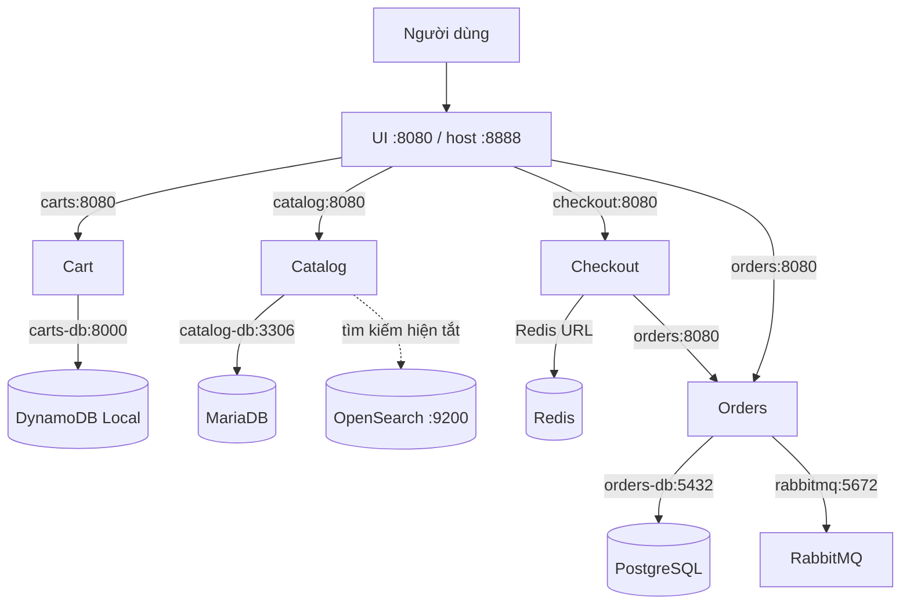

# Nhóm 14 — SERVICES.md

> **Tài liệu dùng chung cho thành viên và AI trợ lý**  
> Môn: Hệ tính toán phân bố · Đề tài: Cloud-native microservices with autoscaling  
> Người phụ trách: **B — App & Container** · Trạng thái: **Bản đặc tả local đã khảo sát; AWS deployment chưa xác minh**  
> Ngày tổng hợp: 31/10/2026

## 0. Hướng dẫn bắt buộc dành cho AI đọc tài liệu

1. Luôn hỗ trợ bằng **tiếng Việt**; lệnh thực hành ưu tiên **Windows PowerShell + Docker Desktop (WSL2 backend) + VS Code**. Phân biệt lệnh PowerShell và Bash.
2. Chỉ coi thông tin trong phần **“Đã xác minh”** là dữ kiện về môi trường local do thành viên B quan sát. **Không biến giả định/đề xuất thành sự thật**, không giả vờ đã kiểm chứng cấu hình AWS.
3. Nguồn ứng dụng: `https://github.com/aws-containers/retail-store-sample-app`; source đã clone tại commit `d7a380b843e0759e58754f74188ea18252a51415`. Container image local quan sát được mang tag **1.6.3**. **Commit source và image tag không tự động chứng minh cùng một bản build**; đối chiếu release nếu cần tính tái lập nghiêm ngặt.
4. Nhóm chính thức dùng **ECS Fargate**, **ECR**, **ALB**, **Terraform**, **GitHub Actions**, **CloudWatch**, AWS region **`ap-southeast-1` (Singapore)**. **Không hướng dẫn theo EKS/Kubernetes** trừ khi nhóm trưởng A đổi quyết định.
5. **A** dựng hạ tầng/Terraform, quyền IAM, mạng, ALB và duyệt PR; **B** phân tích app/container và kiểm thử; **C** CI/CD, build/push/deploy; **D** observability/load test/báo cáo. Không tự tạo tài nguyên AWS tính phí hoặc vượt quyền `b-dev`; gặp `AccessDenied` thì báo A.
6. **Không yêu cầu người dùng gửi file `.env`, access key, mật khẩu, token, hay output `docker compose config` đầy đủ đã nội suy secrets.** Chỉ nhận tên biến hoặc đầu ra đã che giá trị nhạy cảm. Không commit bí mật; môi trường AWS sử dụng cơ chế IAM/secrets do A quản lý.
7. Khi chẩn đoán: **thu thập log/trạng thái → xác định nguyên nhân → sửa tối thiểu → kiểm thử lại**. Không khuyên `docker compose down -v`, `docker volume prune`, `docker system prune` hay đổi mật khẩu database hiện hữu như phản xạ đầu tiên.
8. **Không tự đánh dấu checklist tiến độ thay B.** Chỉ báo mục nào đủ bằng chứng hoàn thành; B tự tick file theo dõi.
9. Khi AI của A/C/D sử dụng file này, phải phân biệt **Docker Compose DNS, image runtime và ECS discovery**: địa chỉ `catalog`, `carts`, `orders-db`… chỉ áp dụng trong network local. Trên AWS cần service discovery/backend phù hợp do A quyết định.

## 1. Phạm vi và nguồn bằng chứng

- **5 microservice nghiệp vụ:** `ui`, `catalog`, `cart`, `checkout`, `orders`.
- **6 container phụ trợ trong Compose đã chạy:** `catalog-db` (MariaDB), `carts-db` (DynamoDB Local), `checkout-redis` (Redis), `orders-db` (PostgreSQL), `rabbitmq`, `opensearch`.
- **Thư mục source:** `src/ui`, `src/catalog`, `src/cart`, `src/checkout`, `src/orders`. Mỗi thư mục có Dockerfile. Ngoài phạm vi 5 service còn có `src/load-generator/Dockerfile`.
- **Bằng chứng được B cung cấp:** nội dung 5 Dockerfile; `docker compose ps -a`; `docker inspect ... Config.Healthcheck / NetworkSettings`; danh sách `depends_on`; tên và một số giá trị **không nhạy cảm** của environment; phản hồi HTTP health của Catalog/Checkout; kiểm thử giao diện giỏ hàng/checkout và màn hình xác nhận đơn hàng.
- **Không phải bằng chứng đã có:** cấu hình ECS trên AWS, load test, thời gian phục hồi, mức chi phí thật, thử nghiệm nhiều task, toàn bộ mã nguồn xử lý state.

## 2. Đặc tả 5 service (đã xác minh ở local)

| Service | Vai trò | Ngôn ngữ/runtime; build | Container port | Health endpoint | Kết nối / lưu trữ | Đánh giá state |
|---|---|---|---|---|---|---|
| **UI** | Giao diện cửa hàng, điều phối request backend | Java 21 (Amazon Corretto), Maven, JAR | **8080**; chỉ UI được publish **host 8888 → 8080** | `GET /actuator/health` | Gọi Cart, Catalog, Checkout, Orders | *Có xu hướng stateless*; chưa xác minh session/state bằng mã nguồn |
| **Catalog** | Danh mục sản phẩm | Go, `go build`, binary `/app/main` | **8080**, HTTP `/health` đã phản hồi `OK` | `GET /health` | MariaDB `catalog-db:3306`; có tùy chọn OpenSearch | *Có xu hướng stateless* nếu dữ liệu ngoài task; cần xác minh cache/state |
| **Cart** | Giỏ hàng | Java 21, Maven, JAR | **8080** | `GET /actuator/health` | DynamoDB Local `carts-db:8000` | Logic giỏ hàng có state nghiệp vụ; container *có thể stateless* nếu mọi replica dùng chung backend |
| **Checkout** | Điều phối checkout | Node.js 20, Yarn, `node dist/main.js` | **8080**, HTTP `/health` đã phản hồi JSON `status: ok` | `GET /health` | Redis (`checkout-redis`); gọi Orders | Cần kiểm tra lifecycle dữ liệu Redis/session và TTL |
| **Orders** | Quản lý đơn hàng và messaging | Java 21, Maven, JAR | **8080** | `GET /actuator/health` | PostgreSQL `orders-db:5432`; cấu hình RabbitMQ `rabbitmq:5672` | Dữ liệu/messaging ở backend ngoài; vẫn cần thử multi-replica và idempotency |

**Giải thích:** “stateless container” không có nghĩa service không xử lý dữ liệu. Đó là kỳ vọng về khả năng thay task/scale replica khi **state lâu dài** nằm ở nơi dùng chung, không chỉ trong memory từng container. Các nhận định state trong bảng là **sơ bộ**, chưa phải kết luận đã kiểm thử.

### 2.1. Dockerfile, runtime, tính bảo mật

| Service | Dockerfile | Build stage / runtime | Entrypoint |
|---|---|---|---|
| UI | `src/ui/Dockerfile` | Maven/Java 21 → Amazon Linux 2023 + Java 21 | `sh -c 'java $JAVA_OPTS -jar /app/app.jar'` |
| Catalog | `src/catalog/Dockerfile` | Go → Amazon Linux 2023 | `/app/main` |
| Cart | `src/cart/Dockerfile` | Maven/Java 21 → Amazon Linux 2023 + Java 21 | `sh -c 'java $JAVA_OPTS -jar /app/app.jar'` |
| Checkout | `src/checkout/Dockerfile` | Node.js 20/Yarn → Amazon Linux 2023 + Node.js 20 | `node dist/main.js` |
| Orders | `src/orders/Dockerfile` | Maven/Java 21 → Amazon Linux 2023 + Java 21 | `sh -c 'java $JAVA_OPTS -jar /app/app.jar'` |

- Dockerfile cả 5 sử dụng multi-stage build; runtime chạy bằng `USER appuser` (không phải root).
- UI/Cart/Orders khai báo `EXPOSE 8080`; Catalog/Checkout không khai báo `EXPOSE`, **nhưng** HTTP health trên `localhost:8080` đã được kiểm chứng với kết quả thành công.
- `EXPOSE` là metadata, không phải lệnh mở cổng trên host hoặc trên ECS.
- Image local kiểm tra: `public.ecr.aws/aws-containers/retail-store-sample-{ui,catalog,cart,checkout,orders}:1.6.3`; chưa có bằng chứng image do CI của nhóm build/push lên ECR riêng.

### 2.2. Health check local

| Service | Command trong Docker health check | Interval | Timeout | StartPeriod | Retries |
|---|---|---:|---:|---:|---:|
| UI | `curl -s -f http://localhost:8080/actuator/health || exit 1` | 10s | 10s | 15s | 3 |
| Catalog | `curl -f http://localhost:8080/health || exit 1` | 10s | 10s | Không được khai báo trong inspect | 3 |
| Cart | `curl -f http://localhost:8080/actuator/health || exit 1` | 10s | 10s | 15s | 3 |
| Checkout | `curl -f http://localhost:8080/health || exit 1` | 10s | 10s | Không được khai báo trong inspect | 3 |
| Orders | `curl -f http://localhost:8080/actuator/health || exit 1` | 10s | 10s | 15s | 3 |

- Phản hồi Catalog đã đo: `OK`.
- Phản hồi Checkout đã đo: JSON có `"status":"ok"`, `"info":{"chaos":{"status":"up"}}`.
- `docker ps` từng cho kết quả **10/11 `(healthy)`, RabbitMQ `Up`**. Không có nhãn `(healthy)` **không đủ để kết luận RabbitMQ hỏng**; xác minh `.Config.Healthcheck` và `rabbitmq-diagnostics` nếu cần.
- ECS container health check, ALB target health check và cơ chế recovery cần A cấu hình phù hợp; không suy ra rằng các setting Compose có thể sao chép nguyên xi.

## 3. Kết nối và dependency

### 3.1. `depends_on` đã liệt kê từ Docker Compose

| Service | `depends_on` |
|---|---|
| UI | `cart`, `catalog`, `checkout`, `orders` |
| Catalog | `catalog-db`, `opensearch` |
| Cart | `carts-db` |
| Checkout | `checkout-redis` |
| Orders | `orders-db` |

**Không nhầm `depends_on` với toàn bộ dependency runtime.** Ví dụ Orders có environment cấu hình RabbitMQ dù không có `rabbitmq` trong danh sách `depends_on` trích xuất.

### 3.2. Kết nối ứng dụng đã xác minh từ environment



**DNS `carts`:** `docker inspect` đối với Cart hiển thị `DNSNames` chứa `carts` và `cart`, vì vậy URL UI `http://carts:8080` hợp lệ trong network local. Đây **không** phải đảm bảo service name trên ECS.

## 4. Biến môi trường — tên/giá trị không nhạy cảm đã thu thập

> Không ghi mật khẩu, token hay access key thật vào tài liệu. Các giá trị URL nội bộ dưới đây là **local-only**; phải thay khi chuyển lên ECS theo quyết định của A.

| Service | Tên biến và giá trị cấu hình đã xác minh |
|---|---|
| UI | `RETAIL_UI_ENDPOINTS_CARTS=http://carts:8080`; `RETAIL_UI_ENDPOINTS_CATALOG=http://catalog:8080`; `RETAIL_UI_ENDPOINTS_CHECKOUT=http://checkout:8080`; `RETAIL_UI_ENDPOINTS_ORDERS=http://orders:8080`; `RETAIL_UI_SEARCH_ENABLED=false`; có `JAVA_OPTS`, `SERVER_TOMCAT_ACCESSLOG_ENABLED` |
| Catalog | `RETAIL_CATALOG_PERSISTENCE_PROVIDER=mysql`; `RETAIL_CATALOG_PERSISTENCE_ENDPOINT=catalog-db:3306`; `RETAIL_CATALOG_SEARCH_ENABLED=false`; `RETAIL_CATALOG_SEARCH_OS_ENDPOINT=http://opensearch:9200`; có `RETAIL_CATALOG_PERSISTENCE_PASSWORD`, `RETAIL_CATALOG_SEARCH_OS_INDEX`, `RETAIL_CATALOG_SEARCH_OS_TLS_SKIP_VERIFY`, `GIN_MODE` |
| Cart | `RETAIL_CART_PERSISTENCE_PROVIDER=dynamodb`; `RETAIL_CART_PERSISTENCE_DYNAMODB_ENDPOINT=http://carts-db:8000`; `RETAIL_CART_PERSISTENCE_DYNAMODB_CREATE_TABLE=true`; có `AWS_ACCESS_KEY_ID`, `AWS_SECRET_ACCESS_KEY` trong cấu hình **local** và `SERVER_TOMCAT_ACCESSLOG_ENABLED` |
| Checkout | `RETAIL_CHECKOUT_ENDPOINTS_ORDERS=http://orders:8080`; `RETAIL_CHECKOUT_PERSISTENCE_PROVIDER=redis`; có `RETAIL_CHECKOUT_PERSISTENCE_REDIS_URL` (không công bố giá trị nếu chứa auth) |
| Orders | `RETAIL_ORDERS_PERSISTENCE_PROVIDER=postgres`; `RETAIL_ORDERS_PERSISTENCE_ENDPOINT=orders-db:5432`; `RETAIL_ORDERS_MESSAGING_PROVIDER=rabbitmq`; `RETAIL_ORDERS_MESSAGING_RABBITMQ_ADDRESSES=rabbitmq:5672`; có `RETAIL_ORDERS_PERSISTENCE_NAME`, `RETAIL_ORDERS_PERSISTENCE_USERNAME`, `RETAIL_ORDERS_PERSISTENCE_PASSWORD`, `RETAIL_ORDERS_MESSAGING_RABBITMQ_USERNAME`, `RETAIL_ORDERS_MESSAGING_RABBITMQ_PASSWORD`, `SERVER_TOMCAT_ACCESSLOG_ENABLED` |

- Trong output của B xuất hiện một biến tên `reschedule` ở Catalog và Orders. **Ý nghĩa chưa xác minh**; không xóa/chỉnh khi chưa đọc source/Compose tương ứng.
- Không đưa credentials giả lập của **DynamoDB Local** thành access key cố định lên AWS. Việc sử dụng IAM task role và quản lý secrets thuộc phạm vi thiết kế với A.
- Search của UI và Catalog **đang tắt** (`false`) mặc dù Compose vẫn chạy OpenSearch. Có thể đề xuất A đánh giá bỏ thành phần này trên AWS nếu phù hợp phạm vi/kiến trúc, không tự bỏ trong cấu hình đã xác minh.

## 5. Chạy local trên Windows — quy trình tái lập

### 5.1. Yêu cầu

- Windows + Docker Desktop chạy Linux containers (WSL2 backend), PowerShell, Git, VS Code.
- Nguồn: `https://github.com/aws-containers/retail-store-sample-app`.
- Thư mục cá nhân B: `D:\Hetinhtoanphanbo_Doan\retail-store-sample-app`. Người khác có thể chọn đường dẫn khác.
- Cấu hình Compose local đã khảo sát: `docker-compose.yaml` tải từ **GitHub Releases** (file này có thể không là một file được Git theo dõi trong source clone). Ghi lại nguồn và phiên bản **1.6.3** để có khả năng tái hiện.

### 5.2. Clone và tải Compose

```powershell
mkdir D:\Hetinhtoanphanbo_Doan -Force
cd D:\Hetinhtoanphanbo_Doan
git clone https://github.com/aws-containers/retail-store-sample-app.git
cd .\retail-store-sample-app
git rev-parse HEAD
Invoke-WebRequest -Uri 'https://github.com/aws-containers/retail-store-sample-app/releases/download/v1.6.3/docker-compose.yaml' -OutFile 'docker-compose.yaml'
```

> Kiểm tra URL/tài nguyên release trước khi sử dụng trong các thời điểm khác. Tránh dùng `releases/latest` khi cần kết quả tái lập. Source commit nêu ở đầu file là phiên bản B đã thử nghiệm; nếu cần khớp chính xác giữa source và image hãy xác minh mapping release.

### 5.3. `.env` là cấu hình local, KHÔNG phải tài liệu công khai

Tạo `.env.example` **không chứa giá trị thật** để hướng dẫn:

```dotenv
DB_PASSWORD=REPLACE_WITH_YOUR_LOCAL_PASSWORD
```

Mỗi người tạo `.env` riêng và điền mật khẩu local đủ mạnh, không rỗng. Nếu database đã khởi tạo, **giữ mật khẩu tương thích với tài khoản hiện có**; thay file `.env` không tự đổi mật khẩu bên trong MariaDB/PostgreSQL/RabbitMQ.

**PowerShell 7 (không in mật khẩu):**

```powershell
$secure = Read-Host 'Nhap mat khau local' -AsSecureString
$plain = [System.Net.NetworkCredential]::new('', $secure).Password
if ([string]::IsNullOrWhiteSpace($plain)) { throw 'Mat khau trong' }
[System.IO.File]::WriteAllText((Join-Path (Get-Location) '.env'), "DB_PASSWORD=$plain`n", [System.Text.UTF8Encoding]::new($false))
Remove-Variable plain, secure
```

**Chú ý:** Nếu mật khẩu có ký tự đặc biệt theo cú pháp dotenv (`#`, dấu nháy, khoảng trắng ở vị trí đặc biệt, xuống dòng), cần viết/escape theo quy tắc dotenv; mẫu lệnh đơn giản trên dành cho giá trị không cần escape. Không gửi `.env` vào chat. Chặn commit `.env`: đưa `.env` vào `.gitignore` của repo nhóm, hoặc với clone local dùng `Add-Content .git/info/exclude '.env'` rồi `git check-ignore .env`.

### 5.4. Kiểm tra và chạy

```powershell
Remove-Item Env:DB_PASSWORD -ErrorAction SilentlyContinue
docker compose -f docker-compose.yaml config --quiet
docker compose -f docker-compose.yaml up -d
docker compose -f docker-compose.yaml ps -a
```

Mở `http://localhost:8888`. Thử: danh sách sản phẩm → xem chi tiết → thêm giỏ → checkout bằng dữ liệu giả → xác nhận đơn. B đã có bằng chứng giao diện đặt hàng thành công ở local, **chưa kiểm chứng AWS**.

### 5.5. Quan sát và dừng an toàn

```powershell
docker compose -f docker-compose.yaml logs --tail=80 catalog orders-db
docker stats --no-stream
docker compose -f docker-compose.yaml down
```

`down` dừng/xóa container và network nhưng không chủ động xóa named volumes; **không thêm `-v`** nếu cần giữ dữ liệu. Cẩn thận: những service dùng storage không bền vững có thể mất dữ liệu dù không dùng `-v`.

## 6. Lỗi thực tế đã gặp và bài học

| Hiện tượng B đã gặp | Bằng chứng | Nguyên nhân / trạng thái kết luận | Bài học |
|---|---|---|---|
| `DB_PASSWORD variable is not set` khi mở phiên PowerShell mới | Compose cảnh báo default blank | Biến môi trường phiên trước không còn; đã tạo `.env` local, sau đó `up -d` chạy 11 container; riêng việc `.env` là nguyên nhân duy nhất của mọi lỗi **chưa được chứng minh** | Quản lý cấu hình có tính tái lập, không dùng password rỗng |
| PostgreSQL `orders-db` restart, `Database is uninitialized and superuser password is not specified` | Log `orders-db` | Có bằng chứng thiếu `POSTGRES_PASSWORD` tại lần khởi tạo đó; ở lần sau đã `healthy` | Đọc log cụ thể, tránh sửa lung tung |
| `catalog` từng `unhealthy` | `dependency failed to start` | **Chưa có root cause chắc chắn**; lần khởi động lại sau đã `healthy` | Không suy luận health failure luôn do DB password |
| RabbitMQ chỉ hiện `Up` | `docker compose ps` | Chưa xác minh cấu hình Docker health check RabbitMQ; không mặc định là lỗi | Phân biệt process Up và health status |
| `docker system df` mất kết nối Docker API một lần | Lệnh sau thành công | Sự cố kết nối tạm thời, chưa đủ kết luận Engine hỏng | Kiểm tra lại Docker Desktop/Context |

## 7. Bàn giao theo vai trò và các việc chưa xác minh

### Cho A — Platform / Autoscaling

- Dùng bảng service, port, health path, kết nối và các biến môi trường để xây **ECS Task Definition** và service discovery.
- Xác nhận phương án lưu trữ AWS trước ngày bàn giao ADR-001: (1) in-memory, (2) hybrid có backend chia sẻ, (3) backend đầy đủ. **Chưa chốt phương án**; B phải phân tích tác động đến autoscaling và chi phí Singapore, A phê duyệt.
- Đề xuất thay Docker DNS hostnames bằng endpoint AWS thực tế; A quyết định network/subnet và IAM/secrets. CPU/RAM ECS ban đầu **chưa có số liệu đủ để chốt**.

### Cho C — CI/CD / DevSecOps

- Năm Dockerfile chính nằm trong `src/{ui,catalog,cart,checkout,orders}/Dockerfile`.
- Image local có tag `1.6.3`; CI của nhóm nên build/tag theo commit SHA, quét image, push ECR qua **GitHub OIDC** (C và A phụ trách).
- Lệnh build đề xuất dạng mẫu, cần kiểm thử theo đúng build context từng service:

```powershell
docker build -f .\src\ui\Dockerfile -t group14-ui:local .\src\ui
```

### Cho D — Observability / Load test

- Luồng nghiệp vụ đã kiểm thử local: duyệt sản phẩm → thêm giỏ → checkout → xác nhận đơn.
- Dùng các luồng này để thiết kế k6; khi thử tải AWS chỉ dùng ALB nhóm sau khi thông báo A, phải ghi workload, error rate, p95, số task, CPU/RAM, thời gian phục hồi.

### Cần hoàn thiện trước khi đánh dấu `SERVICES.md` cuối cùng

- [ ] Kiểm tra source/config về chế độ **in-memory** của từng service và thử nghiệm restart/multi-replica.
- [ ] Xác minh các API nghiệp vụ, health readiness thực sự kiểm tra những dependency nào.
- [ ] Xác minh cấu hình credentials không nhạy cảm, RabbitMQ health/connection và biến `reschedule`.
- [ ] Đối chiếu Compose release tag với commit source/ảnh image để bảo đảm reproducibility.
- [ ] Viết `docs/diagrams/service-dependency.md` bản chính thức, `docs/adr/ADR-001-data-store.md`, `app/ecs-container-spec.md`.
- [ ] Sau khi A triển khai AWS: kiểm thử service discovery, ALB E2E, scale nhiều task, fault recovery với bằng chứng thời gian.

## 8. Quy tắc cập nhật tài liệu

- Cập nhật kèm **ngày, phiên bản, nguồn kiểm chứng** (lệnh hoặc file), trạng thái *Đã xác minh / Sơ bộ / Chưa xác minh*.
- Không sửa kết quả đo cũ để phù hợp giả thuyết mới; ghi thay đổi thành ghi chú bổ sung.
- Tài liệu chia sẻ trong repo nhóm qua nhánh `app/...` và Pull Request do A duyệt, **không push thẳng `main`**.
- Trước khi gửi cho AI thành viên khác: có thể dán tài liệu này để cung cấp bối cảnh, nhưng **không dán `.env`, thông tin đăng nhập hay output chứa secrets**.
