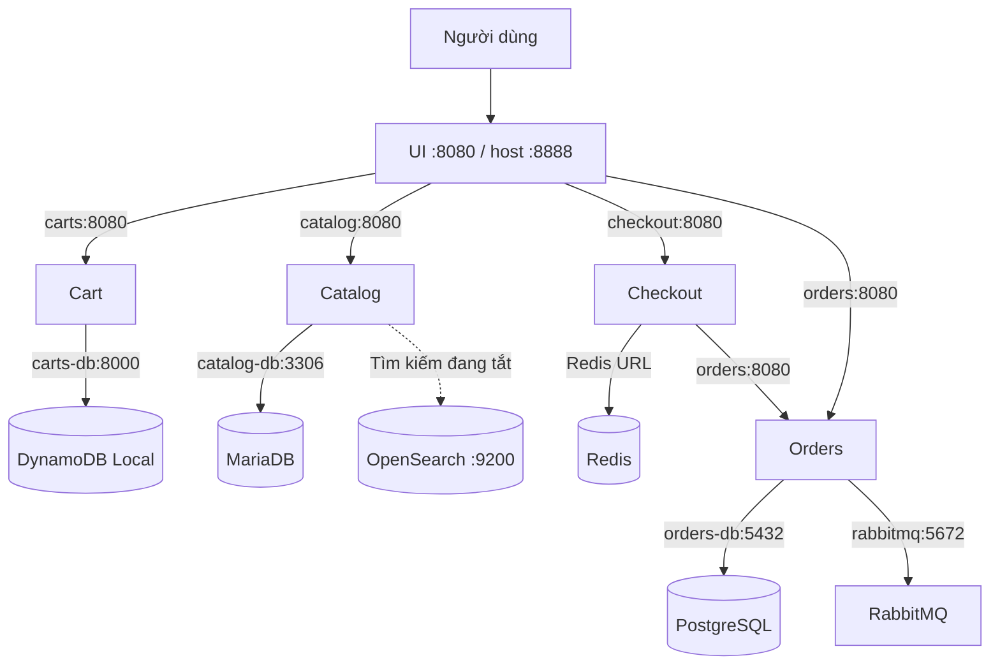

# Service Dependency Diagram – Nhóm 14

**Đề tài:** Cloud-native Microservices with Autoscaling  
**Phụ trách:** B – App & Container  
**Ứng dụng:** AWS Retail Store Sample App v1.6.3

## 1. Tổng quan

Tài liệu mô tả mối quan hệ giữa năm microservice của ứng dụng Retail Store và các thành phần lưu trữ, messaging trong môi trường Docker Compose local.

Sơ đồ được tách từ tài liệu [SERVICES.md](../../app/SERVICES.md) để thành viên A, C, D dễ tham khảo khi triển khai ECS Fargate, CI/CD và kiểm thử tải.

## 2. Sơ đồ phụ thuộc

## 3. Bảng kết nối giữa các service

| Service | Thành phần phụ thuộc | Mục đích |
|---|---|---|
| UI | Catalog, Cart, Checkout, Orders | Gọi các API nghiệp vụ |
| Catalog | MariaDB | Lưu trữ thông tin sản phẩm |
| Catalog | OpenSearch | Tìm kiếm sản phẩm, hiện đang tắt |
| Cart | DynamoDB Local | Lưu dữ liệu giỏ hàng |
| Checkout | Redis | Lưu trạng thái checkout |
| Checkout | Orders | Gửi yêu cầu tạo đơn |
| Orders | PostgreSQL | Lưu dữ liệu đơn hàng |
| Orders | RabbitMQ | Trao đổi thông điệp |

## 4. Lưu ý khi triển khai trên ECS Fargate

- Các hostname như `carts`, `catalog-db`, `orders-db` là địa chỉ trong Docker Compose local, không tự động sử dụng được trên ECS.
- A cần cấu hình mạng nội bộ, service discovery và endpoint các backend phù hợp trên AWS.
- Năm microservice đều sử dụng cổng container `8080`.
- Health check của UI, Cart và Orders là `/actuator/health`; Catalog và Checkout là `/health`.
- Khi scale nhiều task, dữ liệu cần thiết phải được lưu trữ hoặc chia sẻ phù hợp để tránh mất trạng thái.
- Hiện chưa có bằng chứng xác nhận đầy đủ kết nối AWS và khả năng hoạt động với nhiều replica.

## 5. Phân công sử dụng tài liệu

- **A – Platform:** Tham khảo để cấu hình networking, ECS Services và backend.
- **B – App & Container:** Duy trì sơ đồ, xác minh dependencies và kiểm thử.
- **C – CI/CD:** Tham khảo cấu hình các service khi build và deploy.
- **D – Observability:** Xác định luồng nghiệp vụ cho k6 và theo dõi lỗi.

## 6. Tài liệu tham khảo

- [Đặc tả microservices của nhóm](../../app/SERVICES.md)
- [AWS Retail Store Sample App](https://github.com/aws-containers/retail-store-sample-app)

**Trạng thái:** Đã khảo sát trên Docker Compose local; chưa xác nhận triển khai AWS.